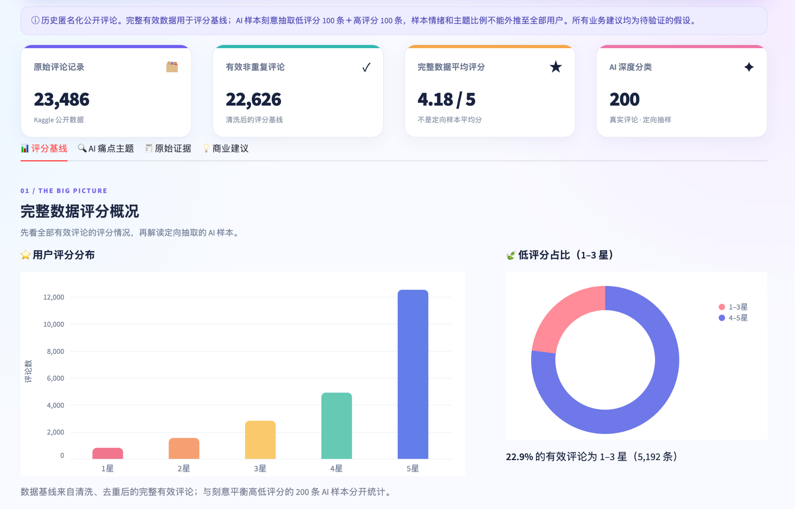
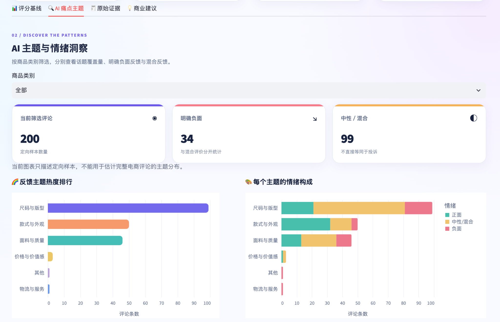
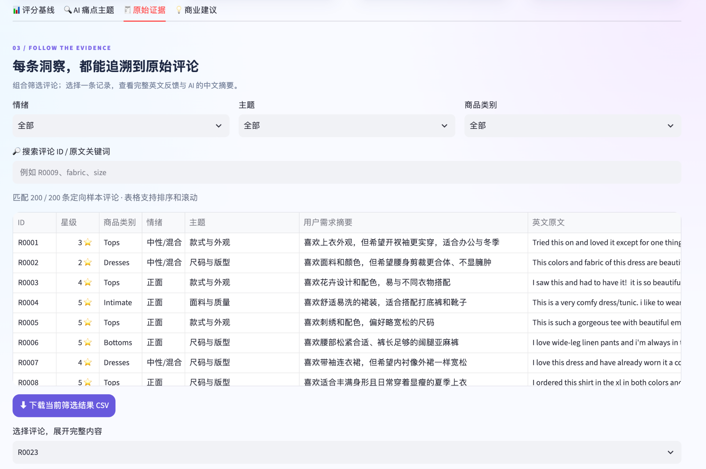
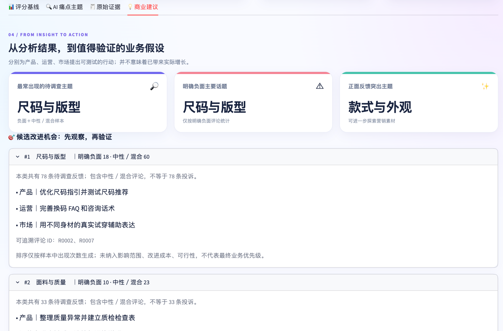

# AI Voice of Customer | AI 用户反馈与商业洞察助手

一个基于**真实、匿名化电商评论**的轻量级 AI 应用作品集：通过 ChatGPT 辅助完成评论情绪分析、反馈主题分类和用户需求提炼，使用 Python 验证、统计，并通过 Streamlit 呈现可交互的商业洞察。适用于**产品、运营、市场和商业分析**方向。

> 这是学习与求职作品，不代表任何品牌的官方业务项目。使用的是历史公开数据，并非实时用户反馈。所有业务建议都是**待验证的假设**，没有实际转化率、GMV 或收入提升结论。

## 📸 在线作品预览（Screenshots）



| AI 主题与情绪洞察 | 原始评论与证据追溯 |
|:--:|:--:|
|  |  |



## 🔍 项目解决的问题

公开用户评论通常是非结构化文本；单看星级评分无法区分用户究竟在抱怨尺寸、面料、款式还是服务。该项目把用户原文转换为可查证的结构化标签和中文需求摘要，辅助团队发现潜在改进机会。

完整流程：**真实评论 → 清洗与定向抽样 → LLM 文本分类 → ID/标签验证 → 人工复核 → 看板与业务建议**。

## 📊 数据与真实结果

| 指标 | 本次项目结果 |
|---|---:|
| Kaggle 数据原始记录 | 23,486 |
| 清洗、去重后有效评论 | 22,626 |
| 完整有效数据平均评分 | 4.18 / 5 |
| 完整有效数据 1–3 星占比 | 22.9% |
| AI 深度分类评论 | 200 |
| 人工复核 | 30 |
| 人工与 AI 情绪标签一致率 | 80.0%（24 / 30） |
| 人工与 AI 主题标签一致率 | 83.3%（25 / 30） |

数据： [Women's E-Commerce Clothing Reviews — Kaggle](https://www.kaggle.com/datasets/nicapotato/womens-ecommerce-clothing-reviews)，数据集页面标注为 CC0，历史匿名化评论。

**抽样限制：** 200 条 AI 评论是从低评分（1–3 星）与高评分（4–5 星）中各定向抽取 100 条，不是代表性随机样本。AI 主题/情绪占比**不可外推到全体消费者**。30 条人工复核是有限的人工一致率检查（存在共同讨论过的个别样本），**不是模型总体准确率**。模型推断也没有通过 API 全自动运行，采用 ChatGPT 分批辅助分类。

## ✨ Dashboard 四个页面

1. **📊 评分基线**：完整有效评论的评分分布与低评分比例，区别于 200 条 AI 定向样本。
2. **🔍 AI 痛点主题**：按商品部门筛选反馈，查看主题热度、情绪构成和交叉统计。
3. **🧾 原始证据**：按主题、情绪、商品类别和关键词筛选；可查看英文原文与中文需求摘要。
4. **💡 商业建议**：分别针对产品、运营、市场提出可验证的候选行动，并披露复核结果。

## 🛠 工具与分工

- **ChatGPT（大语言模型）**：按统一 Prompt 对英文评论进行情绪识别、主话题分类和用户需求摘要。模型的确切版本以实际使用记录为准。
- **Python / Pandas**：数据清洗、样本抽取、CSV 合并、合法性检查、统计和人工复核一致率计算。
- **Streamlit / Altair**：多页交互式数据看板、可视化和证据追溯。
- **人工负责**：确定研究问题、设计标签体系与提示词、独立复核、解释局限性、提出业务测试假设。

## 🚀 直接运行已完成的 Dashboard

代码仓库包含展示用的三个派生文件 `data/full_summary.json`、`data/enriched_reviews.csv` 和 `data/manual_check.csv`，所以无需重新调用 AI 即可打开看板。

```bash
python3 -m venv .venv
source .venv/bin/activate
python -m pip install -r requirements.txt
python -m streamlit run app.py
```

浏览器打开 `http://localhost:8501`。

## 🔁 从原始数据重新构建

1. 从 Kaggle 下载 `Womens Clothing E-Commerce Reviews.csv`，放入 `data/raw/`。
2. 运行 `python scripts/prepare_data.py` 清洗并抽样。
3. 运行 `python scripts/batch_labels.py split` 拆成 5 批。
4. 根据 `prompts/01_ai_classification.md` 对各批评论进行 ChatGPT 分类，将结果保存为 `data/batches/ai_labels_01.csv` 到 `ai_labels_05.csv`。
5. 运行 `python scripts/batch_labels.py combine` 和 `python scripts/validate_labels.py`。
6. 完成 `data/manual_check.csv` 中的 30 条人工标注，运行 `python scripts/generate_report.py`。

**重要：** 手工与 AI 的分类判断含有主观性，每次重新调用模型不保证与仓库展示数据完全一致。

## 📁 主要结构

```text
app.py                     # 彩色交互式 Dashboard
requirements.txt           # Python 依赖
scripts/                   # 清洗、合并、验证、报告生成
prompts/                   # AI 分类与业务洞察 Prompt
outputs/                   # 统计报告及业务分析输出
data/
  full_summary.json        # 全量有效数据统计（部署需要）
  enriched_reviews.csv     # 200 条标签和原文（部署需要）
  manual_check.csv         # 30 条人工复核（展示一致率需要）
  raw/                     # 原始数据本地保留，不上传
docs/screenshots/          # Dashboard 截图
```

## 📌 方法与业务边界

- 仅作为历史公开匿名数据上的演示项目，不构成针对真实品牌的运营决策。
- 「出现频繁」和「明确负面」不能混为一谈；中性/混合不直接等于投诉。
- 排名基于定向样本内计数，没有结合市场规模、成本、实施难度或 A/B 测试效果。
- 所有改进措施均建议在实际业务环境中通过进一步定性访谈、用户实验或 A/B 测试验证。
